# 🧬 PowerPrep: Grade 12 Life Sciences exam prep

**Timed, exam-style practice for South African matric learners: real NSC past papers with memo self-marking, AI note summaries, teacher classes, set tests and live online lessons.**

[](https://life-sciences-grade12-tester.vercel.app)


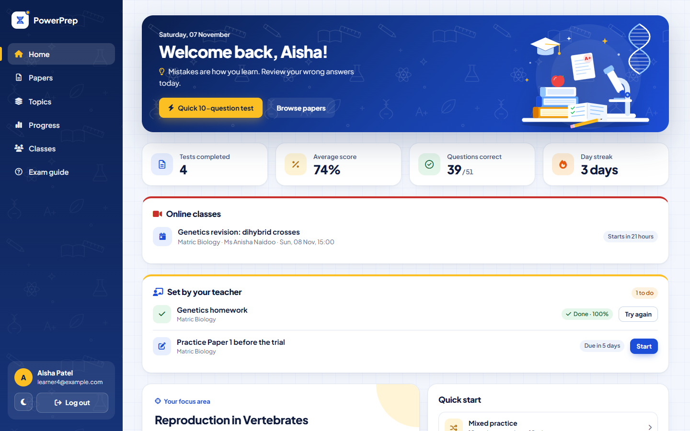

**Contents:** [Try it](#-try-it-in-30-seconds) · [The problem](#-the-problem) · [Features](#-what-it-does) · [Screenshots](#-screenshots) · [Engineering highlights](#-engineering-highlights) · [Architecture](#-architecture) · [Run it locally](#-run-it-locally) · [Roadmap](#-roadmap)

---

## ⚡ Try it in 30 seconds

Open **[life-sciences-grade12-tester.vercel.app](https://life-sciences-grade12-tester.vercel.app)**, click **Log in** and use a demo account. The data is seeded and shared, so please be kind to it.

| Explore as | Email | Password | What to look at |
|---|---|---|---|
| 🎓 **Learner** | `learner4@example.com` | `123456` | Home → **Online classes** and **Set by your teacher** · **Papers** → real NSC papers, open a memo, **Mark it** · **AI notes** → upload a PDF of notes and get a revision sheet · start a test, flag a question, **Save & exit**, then resume · **Progress** charts |
| 👩‍🏫 **Teacher** | `teacher2@example.com` | `123456` | **Classes → Open class** → learners table, **Topic insights**, **Set tests**, **Online classes** (go live or schedule) |
| 🛡️ **Admin** | *not public* | | See the [admin screenshot](#-admin) below |

> Tip: toggle 🌙 dark mode in the sidebar, and try it on your phone.

---

## 🎯 The problem

Grade 12 learners often don't know **which topics are costing them marks**, and teachers have little visibility into where a class is struggling between tests. PowerPrep turns every answered question into data. Learners see their weakest topic and get one-tap practice for it, and teachers see the same insight across their whole class. Official past papers, memo self-marking and AI note summaries mean learners can revise in one place, even on a phone with limited data.

## ✨ What it does

### 🎓 Learners
- **Timed tests**: two exam-style practice papers (following the DBE Paper 1 / Paper 2 topic split), quick 10-question mixed tests, or one topic at a time
- **Test tools**: a **question navigator** with flagging, keyboard shortcuts (`A`–`D`, `←`/`→`, `F`) and a submit check that warns about unanswered and flagged questions
- **Pause and resume**: leaving a test or refreshing the page keeps the answers and the timer
- **Results and review**: score, topic breakdown and a recommendation, then every question with the correct answer and an explanation (filter by incorrect or unanswered)
- **Progress**: per-topic mastery, a "focus area", a score history chart and a daily streak, all calculated from real answers
- **Real NSC past papers**: every official Life Sciences Paper 1 and Paper 2 with memos from **2015 to 2026**, opened from the Department of Basic Education website
- **Mark it against the memo**: write the paper, mark it with the official memo and enter marks per question; the score counts towards progress, streak and the teacher's class view
- **AI notes**: upload a PDF or text file (or paste notes) and get a revision sheet with a summary, key terms, must-know facts and exam-style questions with answers; copy it, download it, save it as a PDF, or keep it in a personal library
- **Classes**: join a teacher's class with a 6-character code (and leave any time); set tests and online lessons appear on Home

### 👩‍🏫 Teachers
- **Classes**: create classes with **join codes**, and see each learner's tests, average, accuracy, last test and weakest topic
- **Topic insights**: how the whole class does per topic, weakest topics first
- **Set tests**: a paper, a topic or a mixed set, with due dates; see who has completed it and their best score
- **Online classes**: go live instantly or schedule a lesson, in a free video room (Jitsi) or with the teacher's own Google Meet / Zoom / Teams link. Learners get a **Live now → Join** button and attendance is recorded.

### 🛡️ Admin
- **Teacher requests**: approve or decline requests for teacher access, and revoke it later
- **Accounts**: see every account with its activity
- **Question bank**: import, add, edit and hide questions in the app, with validation

---

## 📸 Screenshots

| Test in progress | Answer review |
|---|---|
| 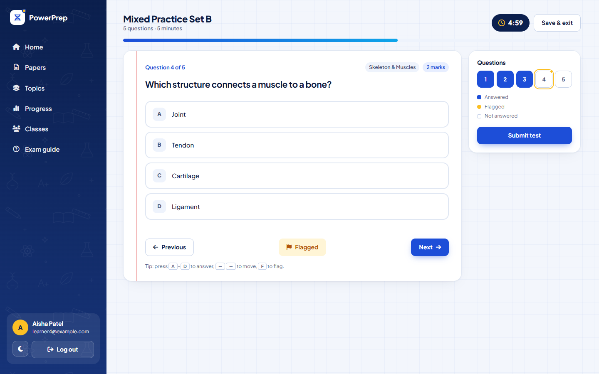 | 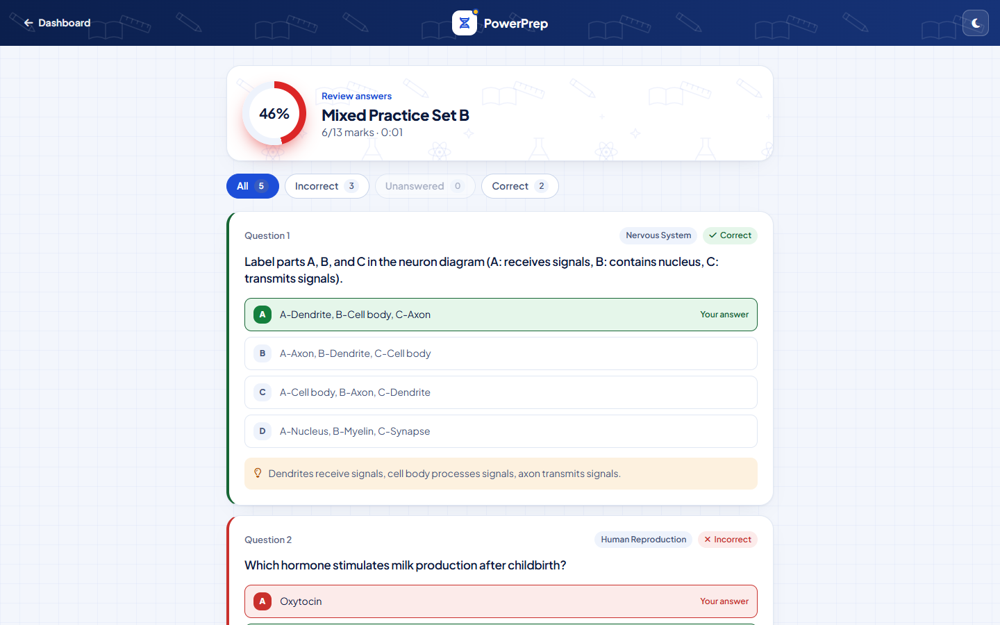 |

| Results | Progress |
|---|---|
| 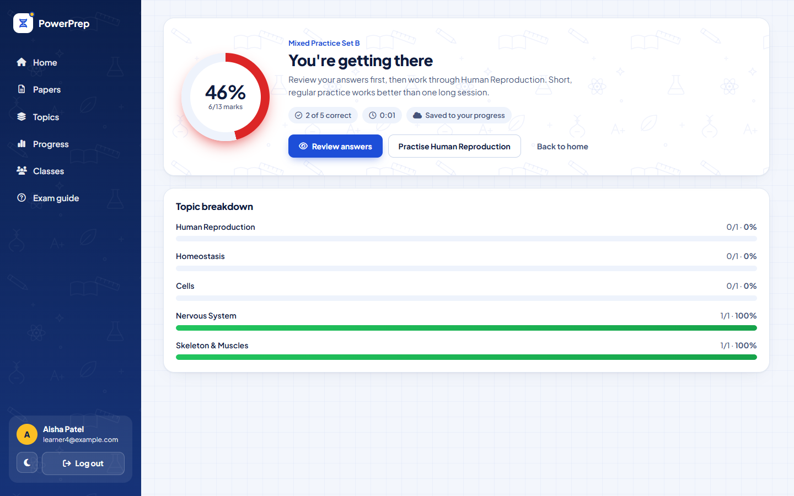 | 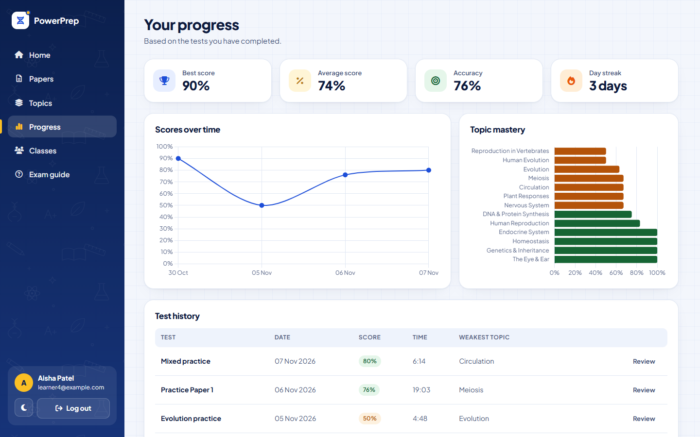 |

| Official NSC past papers | Marking against the memo |
|---|---|
| 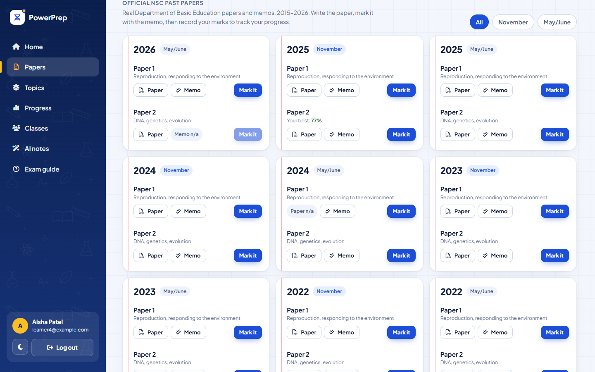 | 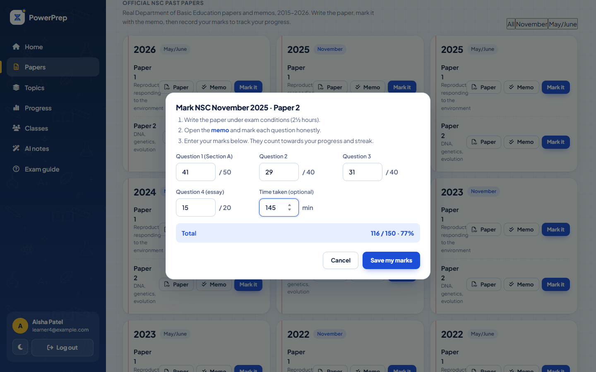 |

#### ✨ AI notes
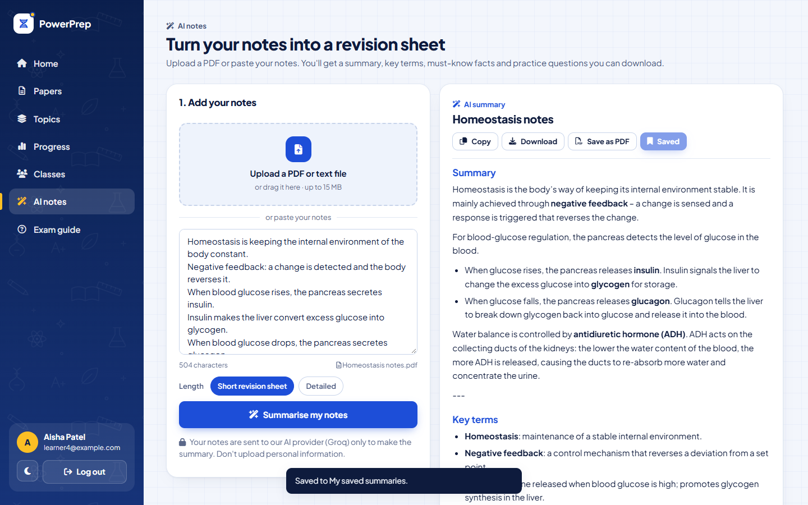

| Teacher: class overview | Teacher: online classes |
|---|---|
| 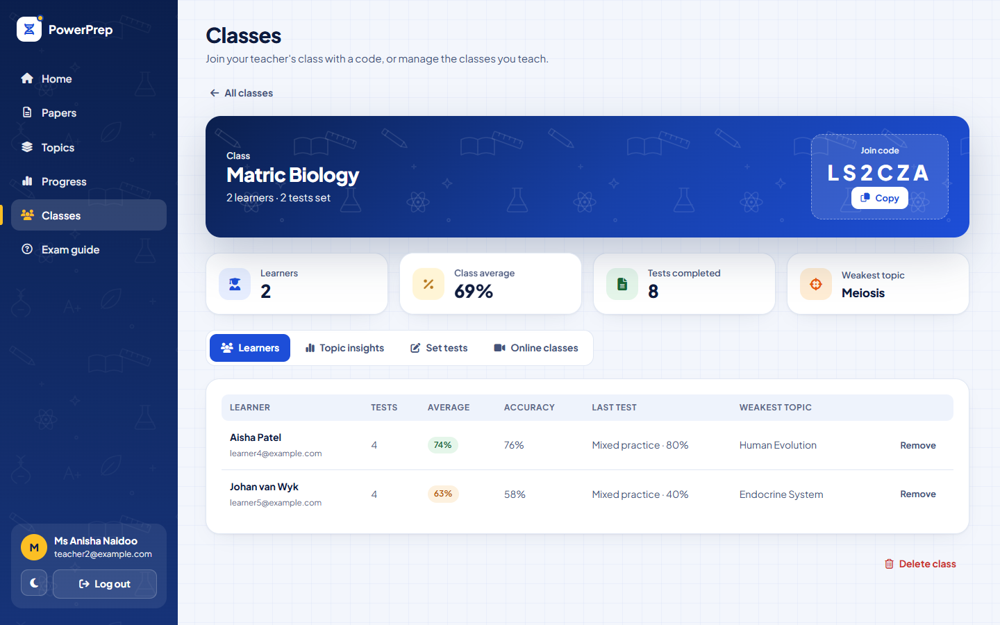 | 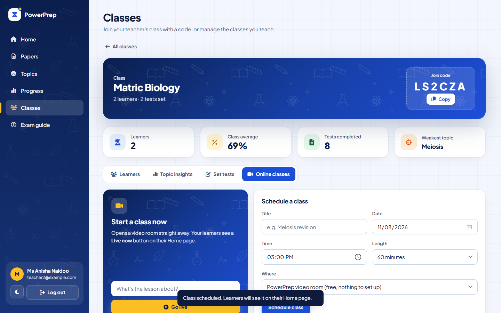 |

#### 🛡 Admin
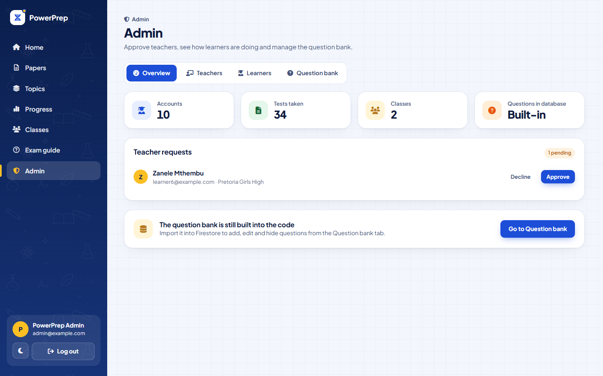

| Landing page | Dark mode | Phone |
|---|---|---|
| 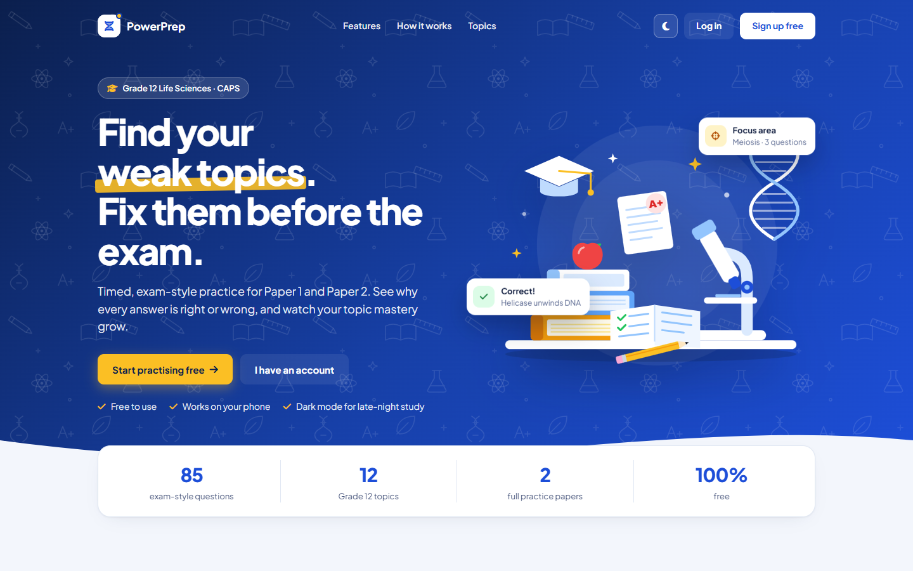 | 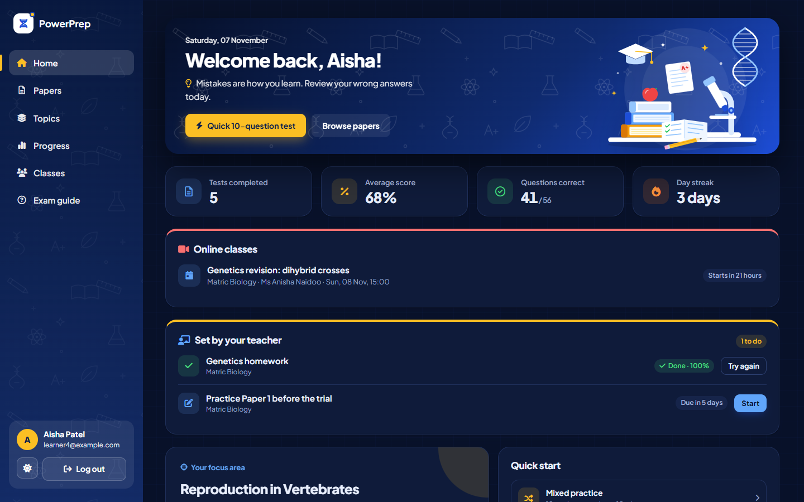 | 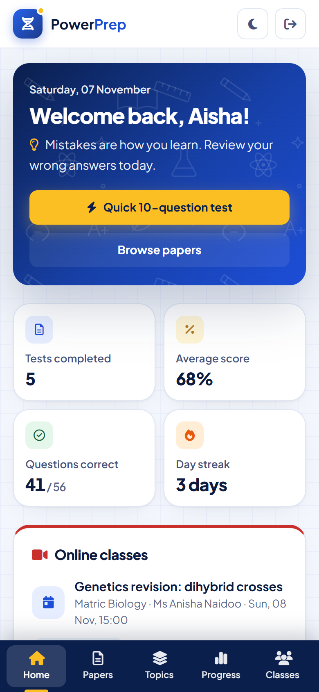 |

---

## 🛠 Engineering highlights

**Security is enforced in the database, not the UI.**
- Learner, teacher and admin roles are enforced by [Firestore security rules](firestore.rules).
- Learners can only touch their own data, teachers only see learners who joined *their* classes, only admins can grant roles or change questions, and saved results can't be edited.
- The core rules (roles, profiles, results, questions, classes, members and set tests) are covered by **[56 allow/deny tests](tests/rules/rules.test.mjs)** for the Firestore emulator.
- The newer online-class, attendance and AI-usage rules were checked against the live project with the demo accounts, including attempts to break them (joining a class you're not in, marking someone else present, resetting your own AI limit).

**AI without exposing the key.**
- The Groq API key exists only as a Vercel secret. The browser calls [`/api/summarize`](api/summarize.js), a serverless function that checks the Firebase sign-in, enforces a **daily limit per learner** and only then calls Groq.
- The daily counter is stored in Firestore under rules that only let it **go up by one**, so a learner can't reset their own limit, even though the write uses their own sign-in.
- Uploaded notes are wrapped as data in the prompt, and the model is told never to follow instructions inside them (a prompt-injection defence). PDFs are read **in the browser** with pdf.js, so only the extracted text is sent.
- If Groq retires the configured model, the function switches to a current one automatically.

**Real past papers, checked one by one.**
- A scraper pulled every Life Sciences entry from the DBE's year pages (21 exam sessions). Each of the 84 English papers and memos was then **downloaded and its cover page read** to confirm the subject, paper number, year and paper-vs-memo.
- That caught **two broken links on the DBE site itself**: a 2026 memo that is actually *Information Technology*, and a 2024 "Paper 1" that serves the memo. They show as "n/a" instead of sending learners to the wrong file.
- The papers stay on the DBE website (© Department of Basic Education); the app links to them rather than copying them.

**The data model is built for cheap reads.**
- Each learner's running totals and per-topic stats are kept with atomic `increment()` writes, so dashboards never re-add up the history, and two open tabs can't overwrite each other.
- Class progress is mirrored into the class roster, so a teacher's view is a single collection read and never needs access to a learner's private profile.

**The test engine doesn't lose work.**
- Unfinished tests are saved locally after every answer, and resume after leaving the page or refreshing.
- Answer options are shuffled on every attempt with a [Fisher–Yates](dashboard/questions.js) shuffle. Answers are stored against the original option order, so scoring, review and old results stay correct.

**No framework and no build step.**
- Plain ES modules (27 files, about 11,000 lines), deployed as static files on Vercel plus one serverless function.
- A small shared design system ([`shared/theme.css`](shared/theme.css)) drives light and dark mode with CSS custom properties.
- The illustrations are hand-drawn SVG.

**It's accessible and tested.**
- Four **[Playwright journeys](tests/e2e)** cover the learner, school, online-class, past-paper and AI-notes flows end to end. They run against an in-memory Firebase fake that answers asynchronously like a real network, which is what caught a real save bug before it reached learners.
- A **[unit test](tests/unit/markdown.test.mjs)** covers the Markdown renderer for AI summaries, including HTML escaping.
- Every screen they visit goes through an **automated WCAG AA contrast audit** in light *and* dark mode (0 issues), plus a check for sideways scrolling on a phone-sized screen.

---

## 🏗 Architecture

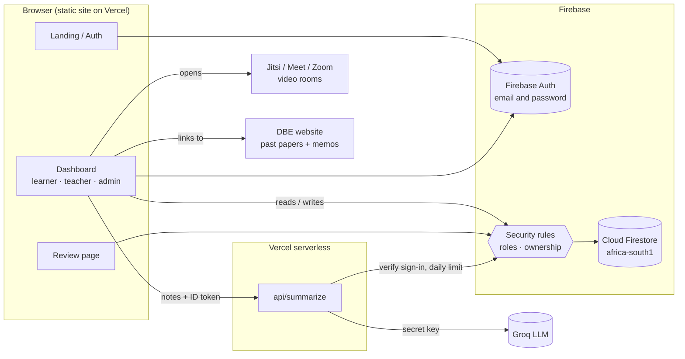

| Collection | Holds | Who can read / write |
|---|---|---|
| `users/{uid}` | Profile, running totals, per-topic stats, class IDs | The learner · admins can read |
| `testResults/{id}` | One finished test with every answer | The owner · admins can read · never editable |
| `roles/{uid}` | `admin` or `teacher` | The owner can read · only admins write |
| `classes/{id}` with `members`, `assignments`, `sessions` | The class, its roster with progress, set tests and submissions, online classes and attendance | The class teacher · members see what applies to them |
| `classCodes/{code}` | Join code → class | Look up one code; can't be listed |
| `questions/{id}` | The question bank (once imported) | Everyone signed in reads · admins write |
| `users/{uid}/summaries/{id}` | AI summaries the learner saved | The learner only |
| `aiUsage/{uid}` | Today's AI usage count | The learner · can only go up by one |

---

## 🧰 Tech stack

- **Frontend:** HTML, CSS (custom properties, grid), JavaScript ES modules, Chart.js, Font Awesome
- **Backend:** Firebase Authentication, Cloud Firestore, Firestore security rules, a Vercel serverless function
- **AI:** Groq (OpenAI-compatible chat API), with pdf.js reading PDFs in the browser
- **Testing:** Playwright, Firebase rules-unit-testing with the emulator, a custom contrast audit, Node unit tests
- **Hosting and tooling:** Vercel, Firebase CLI, Git and GitHub

## 📁 Project structure

```
index.html                 Landing page
shared/                    Design system (theme.css) and UI helpers (ui.js)
assets/                    SVG illustration, doodle patterns and favicon
api/summarize.js           Serverless function: sign-in check, daily limit, Groq call
auth/                      Login, sign-up, Firebase config
dashboard/
  index.html               Dashboard shell: home, papers, topics, progress, classes, AI notes, admin, test, results
  dashboard.js             Routing, test engine, results
  data.js                  Profile and results (Firestore)
  school-data.js           Roles, classes, set tests, online classes, admin data
  classes.js · online.js   Classes page and online classes
  official-papers.js       Official NSC papers and memo self-marking
  past-papers.js           Verified DBE paper and memo links (2015–2026)
  notes.js                 AI notes page
  admin.js                 Admin page
  progress.js              Charts
  questions.js             Question bank, papers and topics
  review-answers.*         Answer review page
firestore.rules            Security rules
tests/
  e2e/                     Playwright journeys, contrast audit, Firebase fake
  rules/                   Security-rule tests (Firestore emulator)
  unit/                    Unit tests
scripts/seed.mjs           Seeds demo accounts and data (Admin SDK)
```

---

## 🚀 Run it locally

ES modules need to be served over HTTP:

```bash
git clone https://github.com/Responcebility/LifeSciences-Grade12-Tester.git
cd LifeSciences-Grade12-Tester
npx serve .            # or: python -m http.server 5500
```

The app talks to the hosted Firebase project, so the demo accounts above work locally too. On `localhost:5500`, AI notes call the deployed `/api/summarize` function (it allows that origin), so summaries work locally without a key on your machine.

### Tests

```bash
cd tests
npm install
npm run setup          # downloads Playwright's Chromium once
npm run test:unit      # 8 checks of the Markdown renderer for AI summaries
npm run test:e2e       # 4 user journeys + contrast audit (THEME=dark for dark mode)
npm run test:rules     # 56 core security-rule tests in the Firestore emulator (needs Java 21+)
```

### Your own Firebase project

1. Create a project, enable **Email/Password** (and optionally **Google**) sign-in, and create a Firestore database.
2. Put your web config in [`auth/firebase-config.js`](auth/firebase-config.js) and your project ID in `.firebaserc`.
3. Deploy the rules and indexes: `firebase deploy --only firestore`
4. For AI notes, add a Groq key as a Vercel secret with `vercel env add GROQ_API_KEY production` (optional settings: `GROQ_MODEL`, `AI_DAILY_LIMIT`).
5. Seed demo data with [`scripts/seed.mjs`](scripts/seed.mjs) (needs a service account key, which is git-ignored). Or create the first admin by adding `roles/{yourUid} = { role: "admin" }` in the Firestore console.

---

## 🗺 Roadmap

- Afrikaans past papers and memos (the DBE publishes both; the same link check applies)
- Emulator tests for the online-class and AI-usage rules, and running all tests in GitHub Actions
- Video embedded inside the app (Jitsi as a Service or Daily) instead of a new tab
- Structured and diagram questions with marking memos, alongside multiple choice
- Spaced repetition of questions a learner got wrong
- Offline support as an installable PWA, for learners with limited data

## 📌 Notes

- The practice questions are **exam-style questions written for this app**. Official NSC papers and memos are **linked** from the Department of Basic Education website, not copied (© Department of Basic Education).
- AI summaries can contain mistakes; the app says so under every summary.
- The demo accounts use a simple shared password on purpose; a real deployment should use strong passwords and remove them.

## 👨‍💻 Author

**Responcebility** ([@Responcebility](https://github.com/Responcebility)): Computer Science student building practical, learner-centred software.
Portfolio: **[responcebility-digital-potfolio.vercel.app](https://responcebility-digital-potfolio.vercel.app)**
